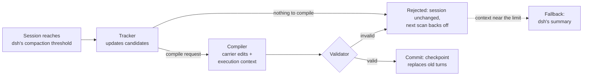
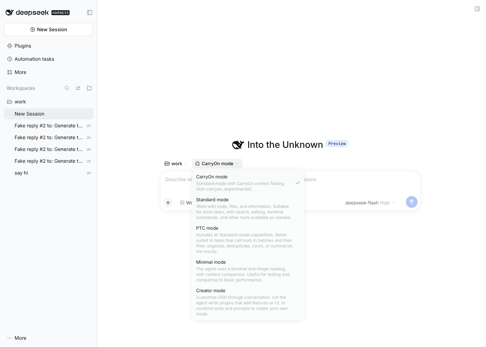

<h1 align="center">dsh-carryon</h1>

<p align="center">
  <strong>CarryOn context folding for DeepSeek Harness: long agent sessions keep what they established, not the whole transcript.</strong>
</p>

<p align="center">
  <a href="https://ethannju.github.io/carryon/"></a>
  <a href="https://arxiv.org/abs/2610.18784"></a>
  <a href="https://huggingface.co/papers/2610.18784"></a>
  <a href="https://github.com/xuan-tu-ai/dsh-carryon/actions/workflows/ci.yml"></a>
  <a href="LICENSE"></a>
  <a href="https://github.com/deepseek-ai/deepseek-harness"></a>
  
</p>

<p align="center">
  <strong>English</strong> · <a href="README.zh-CN.md">简体中文</a>
</p>

When a [DeepSeek Harness](https://github.com/deepseek-ai/deepseek-harness) (dsh) session grows long, dsh compacts it
by summarizing old turns into free text. dsh-carryon replaces that step with **CarryOn** from
[*Pack Light, CarryOn*](https://arxiv.org/abs/2610.18784). Old turns are folded into small, versioned records of
what the agent has established ("carriers") and an execution context: the task, open obligations and the next step.
Each fold is validated before it is committed, and a rejected fold changes nothing.

https://github.com/user-attachments/assets/5f4a6889-5cf6-41a4-aff1-327a9d5d6b7b

<p align="center"><sub>CarryOn demo by the paper's authors. Also on the <a href="https://ethannju.github.io/carryon/">project page</a>.</sub></p>

<p align="center"></p>
<p align="center"><sub>The CarryOn runtime, from the paper. In dsh-carryon, dsh decides when to fold and keeps the recent turns; the Grounder is not ported yet (<a href="docs/how-it-works.md">details</a>).</sub></p>

[Configuration](docs/configuration.md) · [How it works](docs/how-it-works.md) · [Development](docs/development.md) · [Benchmark](bench/README.md) · [Releasing](docs/release.md) · [Changelog](CHANGELOG.md)

## Highlights

- **Drop-in backend.** dsh-carryon replaces dsh's compaction in the terminal, headless, SDK and ACP profiles. dsh
  keeps its trigger, its verbatim tail and its safety checks, and `/compact` works as before.
- **CarryOn mode in the Web UI.** The plugin adds a mode next to Standard mode, so you can compare both in the same
  app.
- **Validated folds.** A fold that fails validation leaves the session untouched. Rescans then back off as in the
  paper. Close to the context limit, a failed fold falls back to dsh's own summary, so the session can go on.
- **Resumable.** Fold state is stored as readable JSON in the session log and restored on resume.
- **Ported, not reinvented.** The runtime is a TypeScript port of [carrycode](https://github.com/xuan-tu-ai/carrycode),
  checked case by case against its parity fixtures.

## How it works



The checkpoint holds every carrier and the execution context. dsh keeps the most recent turns verbatim after it.
A fold costs one Tracker call, plus one Compiler call when the Tracker asks for compilation; dsh's own compaction
makes one summary call. The engine, the state format and how this port differs from the paper are described in
[How it works](docs/how-it-works.md).

## Results reported in the paper

These results come from the paper (Lu, McAuley, Zhang, 2026), with Claude Opus 4.7 as the agent. dsh-carryon has not
been benchmarked against them.

<p align="center"></p>
<p align="center"><sub>OSWorld 2.0. CarryOn improves both binary and partial scores of the same Claude Opus 4.7 agent
while cutting cost per task by 35.9%. Figure from the paper's authors.</sub></p>

<p align="center"></p>
<p align="center"><sub>Context and cost over agent turns on OSWorld 2.0. The baseline's input context keeps growing past
200K tokens, while CarryOn's stays near 65K. Figure from the paper's authors.</sub></p>

On BrowseComp-Plus, the paper reports accuracy rising from 49.0% to 56.0% with 22.9% fewer tokens per task.

## Quick start

You need [dsh](https://github.com/deepseek-ai/deepseek-harness) **0.2.2-alpha.3** (each dsh-carryon release supports
exactly one dsh release), Node.js 22 or later, and pnpm.

> [!NOTE]
> 0.1.0 is not on npm yet. Until then, install from a checkout as described in
> [Development](docs/development.md#run-a-checkout-with-a-real-model).

Install the plugin into the profile you use. For the terminal UI:

```bash
npx @deepseek-ai/dsh@0.2.2-alpha.3 plugin --profile tui add dsh-carryon
```

For the Web UI:

```bash
npx @deepseek-ai/dsh@0.2.2-alpha.3 plugin --profile web add dsh-carryon
```

Restart dsh. In the terminal UI, every compaction is now a CarryOn fold. In the Web UI, new sessions start in
**CarryOn mode**, which you can switch from the mode menu next to the chat box:

<p align="center">
  
</p>

The plugin is listed under **Plugins → Installed plugins**. A fold's checkpoint appears where dsh shows a compaction
summary, and its full state is under Trajectory → Raw Output. To remove the plugin:

```bash
npx @deepseek-ai/dsh@0.2.2-alpha.3 plugin --profile tui remove dsh-carryon
```

## Configuration

The plugin's config row is `carryon-compaction`. It accepts dsh's own compaction keys (`thresholdRatio`,
`retainTokens`, …) and a few CarryOn keys. For example, put this in `$DSH_HOME/profiles/tui/cordis.patch.yml` to fold at
half of the context window and run the CarryOn roles on the cheaper `deepseek-flash`:

```yaml
- id: carryon-compaction
  config:
    thresholdRatio: 0.5
    runtimeProvider: deepseek-official
    runtimeModel: deepseek-flash
```

dsh replaces a row's whole `config` with the patched one, so list all your keys together. See
[Configuration](docs/configuration.md) for every key, the defaults, and the Web UI's limits.

## Citation

dsh-carryon implements the method of this paper. If you use it in research, please cite the paper:

```bibtex
@misc{lu2026carryon,
  title         = {Pack Light, CarryOn: Building Object-Oriented Context for Long-Horizon Agents},
  author        = {Lu, Yuchen and McAuley, Julian and Zhang, Lei},
  year          = {2026},
  eprint        = {2610.18784},
  archivePrefix = {arXiv},
  primaryClass  = {cs.AI},
  url           = {https://arxiv.org/abs/2610.18784}
}
```

carrycode and dsh-carryon are independent reimplementations built from the paper. They are not affiliated with the
paper's authors or with DeepSeek.

## License

dsh-carryon's code is [Apache-2.0](LICENSE). The demo video and the figures shown above belong to the paper's authors,
who gave permission to show them here; they are not covered by that license.
