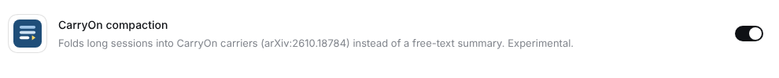

# dsh-carryon

CarryOn context folding ([*Pack Light, CarryOn*](https://arxiv.org/abs/2610.18784), arXiv:2610.18784) as a
compaction plugin for [DeepSeek Harness](https://github.com/deepseek-ai/deepseek-harness) (dsh).

dsh normally compacts a long session by summarizing old turns. With this plugin it does something else: it
**folds** them into small, versioned records of what the agent established ("carriers"), plus an execution
context with the task, open obligations and the next step. A fold is checked before it is committed, and a
rejected fold changes nothing.

> [!WARNING]
> **Experimental, not benchmarked.**
> - Every part has been checked offline with a scripted fake model. A real-model run gates the first npm
>   release ([docs/release.md](docs/release.md)), and 0.1.0 is not on npm until it passes.
> - There are no token or quality measurements yet.
> - Folds add model calls, so a session can cost more than with dsh's own compaction.
> - Try it on sessions you can afford to lose.

The CarryOn runtime is ported from [carrycode](https://github.com/xuan-tu-ai/carrycode), the Python reference
implementation for coding agents. carrycode and dsh-carryon are independent reimplementations built from the paper.
They are not affiliated with the paper's authors or with DeepSeek.

## Install

Requirements:
- dsh **0.2.2-alpha.3** exactly. Each dsh-carryon release supports one dsh release (`engines.dsh`), and dsh refuses
  to activate the plugin on any other version.
- Node.js 22 or later and pnpm, which `dsh plugin` uses.

Install the plugin into each profile where you want it. For the terminal UI:

```bash
npx @deepseek-ai/dsh@0.2.2-alpha.3 plugin --profile tui add dsh-carryon
```

For the Web UI:

```bash
npx @deepseek-ai/dsh@0.2.2-alpha.3 plugin --profile web add dsh-carryon
```

Restart dsh afterwards. The plugin then shows up under **Plugins → Installed plugins** in the Web UI:



To remove it:

```bash
npx @deepseek-ai/dsh@0.2.2-alpha.3 plugin --profile tui remove dsh-carryon
```

## Use

- **Terminal, headless, SDK and ACP profiles.** dsh-carryon replaces the profile's compaction backend. Every automatic
  compaction, and `/compact`, runs a CarryOn fold.
- **Web UI and desktop.** The plugin adds **CarryOn mode** to the mode menu next to the chat box and makes it the
  default for new sessions. Standard mode and the other modes keep dsh's own compaction, so you can compare both.
  A choice of default made in the Web UI wins over the plugin's.


A fold's checkpoint appears where dsh shows a compaction summary. It contains the carriers and the execution
context. The full fold state is readable JSON, shown in Trajectory → Raw Output. It holds the task text and what the
agent established, so treat it like the session itself.

## Configure

The plugin's row is `carryon-compaction`. It takes the keys of dsh's basic backend, such as `thresholdRatio`,
`retainTokens` and `headroomTokens`, plus these:

| Key | Default | Meaning |
| --- | --- | --- |
| `runtimeProvider`, `runtimeModel` | session model | Model for the Tracker and Compiler (set both or neither) |
| `runtimeMaxTokens` | 8192 | Output cap of each role call |
| `maxRequestsPerScan` | 4 | Compile requests per Tracker scan (paper: 4) |
| `rescanTokens` | 6000 | New tokens before a rescan after a failed fold (paper, OSWorld: 6,000) |
| `maxBackoffDoublings` | 6 | Cap on doubling that wait after consecutive failures (paper, BrowseComp-Plus: 6) |
| `fallbackRatio` | 0.95 | Context share of the window from which a failed fold falls back to dsh's summary |
| `compactionRetries` | 0 | dsh's retry on a smaller range; 0 because a retry costs a whole fold |

Where to put the settings:
- For good: in the profile's own `$DSH_HOME/profiles/<profile>/cordis.patch.yml`.
- For one run: in a file passed with `--patch`.

dsh replaces a row's whole `config` with the patched one, so list every key you want to change in one place. For
example, to fold at half of the window and run the runtime roles on dsh's cheaper `deepseek-flash` while the agent
uses `deepseek-v4-pro`:

```yaml
- id: carryon-compaction
  config:
    thresholdRatio: 0.5
    runtimeProvider: deepseek-official
    runtimeModel: deepseek-flash
```

In the Web UI, compaction lives inside each agent preset, and these keys cannot be patched there yet. CarryOn mode
uses dsh's preset defaults (fold at 80% of the window).

## How it works

- `CarryOnCompactionEngine` (`src/engine.ts`) extends dsh's `BasicCompactionEngine` and overrides its
  `summarize()` hook. dsh keeps the trigger, the verbatim tail, the lock bracket, tool-pair-safe edges and the
  shrink check.
- Each `summarize()` call runs one CarryOn fold (`src/fold.ts`) on the region dsh hands it:
  1. The Tracker updates candidates and asks for compilation.
  2. The Compiler proposes carrier edits and a new execution context.
  3. The Validator checks them, and they are committed.
  The checkpoint text (all carriers plus the execution context) replaces the region.
- Fold state is stored in the `compaction/summary` event's `rawOutput`. A session projection (`src/projection.ts`)
  rebuilds it on resume, and a fold counts only after dsh's `compaction/end` reports success.
- A rejected fold changes nothing: dsh records a failed compaction and the history stays. The next scans back off
  as in the paper (Appendix A.3): the wait starts at `rescanTokens` and doubles after each failure, up to
  `maxBackoffDoublings` times.
- Safety net, not in the paper: from `fallbackRatio` of the window up, a failed fold falls back to dsh's own
  summary. The current CarryOn checkpoint is kept in front of it, so the session can go on.
- Cost: a fold makes one Tracker call and, when the Tracker asks for compilation, one Compiler call. Each call is
  retried once on invalid JSON. dsh's basic backend makes one summary call.

### Differences from the paper and from carrycode

- dsh triggers folds by context pressure (`thresholdRatio` of the window), not by a fixed number of new tokens.
- dsh keeps a verbatim tail (`retainTokens`) after each fold.
- The Grounder does not run yet: carriers are not checked against the repository before commit (carrycode M2).
- The fallback to dsh's summary near the window is this plugin's addition.

## Status

| Milestone (carrycode `docs/design/dsh-plugin.md` §8) | State |
| --- | --- |
| P0 spike | done: engine swap, state in `rawOutput`, web CarryOn mode ([findings](docs/p0-findings.md)) |
| P1 core port | done: `records`, `registry`, `validator`, `view` in TS; carrycode parity fixtures pass |
| P2 roles + engine | done offline: Tracker/Compiler over `ctx.llm`, state v1, backoff, fallback ([notes](docs/p2-notes.md)) |
| P3 dogfood | infrastructure done: 4 tasks with hidden tests, headless A/B runner, Web UI runner, report ([bench](bench/README.md), [notes](docs/p3-notes.md)); real-model runs pending |
| P4 release | package, CI and release workflow ready ([release](docs/release.md)); npm publish waits for the real-model smoke test |

What has been run:
- Unit and parity tests.
- An end-to-end check with real dsh and a fake model (`scripts/offline-check.sh`). It covers committed folds,
  rejected folds and fallbacks, and also runs against the packed npm tarball.
- An offline benchmark pass. It only shows that the pipeline works; its numbers say nothing about CarryOn.

No real-model numbers exist yet.

Known issues:
- Profiles without agent presets (terminal, headless) print one warning at startup:
  `[dsh-carryon] patch: entry "agent-preset-registry" not found`. It is harmless. It comes from the patch that makes
  CarryOn mode the Web UI default.

## Development

Needs Node.js 22+, pnpm and about 1 GB for dsh.

```bash
pnpm install
```

```bash
pnpm typecheck && pnpm test
```

```bash
scripts/offline-check.sh
```

The offline check runs without an API key:
- It starts `scripts/fake-messages-server.mjs`, a keyless stand-in for the Messages API that dsh's DeepSeek adapter
  speaks. The server answers the Tracker and Compiler with valid JSON.
- It installs this bundle into a fresh `DSH_HOME` and grows one headless session until dsh folds it.
- It makes folds fail on purpose (`DSH_CARRYON_FAIL=1`), first without and then with the fallback.
- It checks the session log with `scripts/check-fold-log.mjs`.

Two environment variables change what it uses:
- `DSH_BIN` reuses an installed dsh.
- `PLUGIN_SPEC=/abs/path/dsh-carryon-x.y.z.tgz` checks a packed tarball instead of the checkout.

### Run a checkout with a real model

Use a separate `DSH_HOME` and a throwaway repository.

```bash
pnpm install && pnpm build
```

```bash
export DSH_HOME="$HOME/.dsh-carryon"
```

```bash
export DEEPSEEK_API_KEY=sk-...
```

```bash
npx @deepseek-ai/dsh@0.2.2-alpha.3 plugin --profile tui add "file:$PWD"
```

```bash
cd /path/to/throwaway-repo
```

```bash
npx @deepseek-ai/dsh@0.2.2-alpha.3 --profile tui --patch /path/to/dsh-carryon/scripts/real.patch.yml
```

`scripts/real.patch.yml` selects `deepseek-v4.1-flash` (1M-token window) and folds at 5% of it, about 50k tokens.
For an Anthropic-compatible gateway such as Token Harbor, also set `DEEPSEEK_BASE_URL=https://tokenharbor.ai`.
With DeepSeek's own API, drop the `llm-deepseek` and `agent-default-model` rows from the overlay. After
rebuilding, refresh the installed copy with `dsh plugin --profile tui update dsh-carryon`.

To read a session log:

```bash
node scripts/read-session-log.mjs "$DSH_HOME"/sessions/*/<session-id>/session.v4.jsonl.zstd --types compaction/summary,compaction/end
```

### Port parity

The port is checked against carrycode's parity fixtures for records, registry, validator, view, the role messages
and the reply handling. The fixtures and the role prompts are vendored from the carrycode commit recorded in
`carrycode.lock.json` by `pnpm sync:carrycode`. Where dsh differs from carrycode's message format:

- dsh messages are lists of content blocks. `messageText` keeps `text` blocks, renders a `tool-call` block as
  `name(arguments)` and leaves `reasoning` out. carrycode renders OpenAI `tool_calls` instead, so tool calls are not
  part of the parity fixtures.
- Lengths are counted in code points and whitespace follows Python's `str.isspace()`, so token estimates,
  truncation and carrier ids agree with carrycode on non-ASCII text.
- The live-tail boundary helpers (`safe_tail_start`, `build_view`) are not ported: dsh keeps the verbatim tail.

### Layout

| Path | What |
| --- | --- |
| `src/engine.ts` | `CarryOnCompactionEngine`: `summarize()`, backoff, fallback, config |
| `src/fold.ts` | one fold: Tracker → Compiler → Validator → commit, on copies of the state |
| `src/roles.ts` | Tracker and Compiler: user messages, output filtering, prompt loading |
| `src/llm.ts` | JSON role calls over `ctx.llm.stream()` with one retry |
| `src/projection.ts` | session projection that restores fold state on resume |
| `src/state.ts` | fold state (v1) stored in `rawOutput` |
| `src/records.ts` | zod models: carriers, claims, candidates, execution context, Compiler input/output |
| `src/registry.ts` | carrier ids, versioned carrier store, candidate registry |
| `src/validator.ts` | checks a Compiler output before commit; same problem strings as carrycode |
| `src/view.ts` | checkpoint text, step-numbered tail projection, token estimate |
| `src/pystr.ts`, `src/pyjson.ts` | Python string and `json.dumps` semantics the port needs |
| `prompts/` | Tracker and Compiler system prompts, vendored from carrycode |
| `carrycode.lock.json` | carrycode commit and hashes of the vendored prompts and fixtures |
| `cordis.patch.yml` | bundle layer: disable `compaction-basic`, insert `carryon-compaction` (not in web profiles) |
| `web-preset.patch.yml` | generated "CarryOn mode" preset for web profiles (`pnpm gen:web-preset`) |
| `web-default.patch.yml` | makes CarryOn mode the default preset |
| `locale/`, `icon.svg` | title, description and icon shown by dsh's Plugins page and plugin indexes |
| `scripts/` | fake Messages server, offline check, session-log reader, overlays, carrycode sync |
| `bench/`, `scripts/bench/` | P3 benchmark: tasks with hidden tests, grader, headless and Web UI runners, metrics, report, release gate |
| `test/` | unit tests (`node --test`, no network), fold tests with scripted roles, parity test |
| `test/fixtures/parity/` | carrycode's parity fixtures |
| `docs/` | P0 findings, P2 and P3 notes, release process |
| `.github/workflows/` | CI (tests, offline check on the packed tarball) and the tag-triggered npm release |

## License

Apache-2.0. See [LICENSE](LICENSE). Changes are listed in [CHANGELOG.md](CHANGELOG.md).
