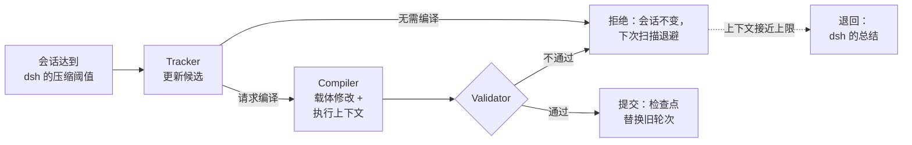
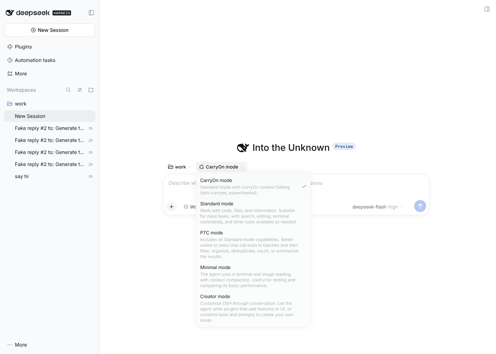

<h1 align="center">dsh-carryon</h1>

<p align="center">
  <strong>为 DeepSeek Harness 提供 CarryOn 上下文折叠：长会话保留已确立的进展，而不是整段历史。</strong>
</p>

<p align="center">
  <a href="https://arxiv.org/abs/2610.18784"></a>
  <a href="https://github.com/xuan-tu-ai/dsh-carryon/actions/workflows/ci.yml"></a>
  <a href="LICENSE"></a>
  <a href="https://github.com/deepseek-ai/deepseek-harness"></a>
  
</p>

<p align="center">
  <a href="README.md">English</a> · <strong>简体中文</strong>
</p>

[DeepSeek Harness](https://github.com/deepseek-ai/deepseek-harness)（dsh）的会话变长时，dsh 会把较早的轮次总结成一段自由文本来压缩上下文。dsh-carryon 用论文 [*Pack Light, CarryOn*](https://arxiv.org/abs/2610.18784) 中的 **CarryOn** 替换这一步：较早的轮次被折叠（fold）成两部分。一部分是记录智能体已确立内容的小型、带版本的记录，称为“载体”（carrier）。另一部分是执行上下文，包含任务、未完成的义务和下一步。每次折叠在提交前都会经过校验，被拒绝的折叠不会改变任何东西。

[配置](docs/configuration.md) · [工作原理](docs/how-it-works.md) · [开发](docs/development.md) · [基准测试](bench/README.md) · [发布](docs/release.md) · [更新日志](CHANGELOG.md)

以上文档为英文。

> [!WARNING]
> **实验性项目，尚未做基准评测。**
> - 所有部分都已用真实的 dsh 和脚本化的假模型检查过。首个 npm 版本要等一次真实模型运行通过后才发布（见[发布门槛](docs/release.md#release-gate-real-model-smoke-test)）。
> - 目前还没有任何 token 用量或质量的测量数据。
> - 折叠会增加模型调用，因此会话成本可能高于 dsh 自带的压缩。

## 特性

- **直接替换。** 在终端、headless、SDK 和 ACP 配置中，dsh-carryon 替换 dsh 的压缩后端。触发条件、原样保留的尾部和安全检查仍由 dsh 负责，`/compact` 照常可用。
- **Web UI 中的 CarryOn mode。** 插件在 Standard mode 旁边新增一个模式，可以在同一个应用里对比两者。
- **折叠经过校验。** 未通过校验的折叠不会改动会话，之后的扫描按论文的方式退避。接近上下文上限时，失败的折叠会退回到 dsh 自己的总结，会话得以继续。
- **可恢复。** 折叠状态以可读的 JSON 保存在会话日志中，恢复会话时会重建。
- **移植而非重写。** 运行时是 [carrycode](https://github.com/xuan-tu-ai/carrycode) 的 TypeScript 移植，逐条对照其一致性测试用例（parity fixtures）检查。

## 工作原理



检查点包含所有载体和执行上下文，dsh 会在它之后原样保留最近的轮次。每次折叠调用一次 Tracker；Tracker 请求编译时，再调用一次 Compiler。dsh 自带的压缩只调用一次总结。引擎、状态格式以及本移植与论文的差异，见[工作原理](docs/how-it-works.md)。

## 论文报告的结果

以下数字来自论文（Lu、McAuley、Zhang，2026），智能体使用 Claude Opus 4.7 测得。dsh-carryon 尚未对照这些结果做过基准测试，见[状态](#状态)。

| 基准 | 指标 | 基线 | 使用 CarryOn |
| --- | --- | --- | --- |
| OSWorld 2.0 | 部分得分 | 43.9% | **49.7%** |
| OSWorld 2.0 | 二值得分 | 15.7% | **19.4%** |
| OSWorld 2.0 | 每个任务的总 token | 40.1M | **19.3M**（−51.9%） |
| OSWorld 2.0 | 每个任务的成本 | $36.8 | **$23.6**（−35.9%） |
| BrowseComp-Plus | 准确率 | 49.0% | **56.0%** |
| BrowseComp-Plus | 每个任务的总 token | 1.56M | **1.20M**（−22.9%） |

收益来自长任务：论文中 OSWorld 的运行长达数百轮，使用 CarryOn 时平均输入上下文稳定在约 65K token，而不是每一轮都在增长。

## 快速开始

需要 [dsh](https://github.com/deepseek-ai/deepseek-harness) **0.2.2-alpha.3**（每个 dsh-carryon 版本只支持一个 dsh 版本）、Node.js 22 或更高版本，以及 pnpm。

> [!NOTE]
> 0.1.0 尚未发布到 npm。在此之前，请按[开发文档](docs/development.md#run-a-checkout-with-a-real-model)从源码检出安装。

把插件安装到你使用的配置（profile）中。终端界面：

```bash
npx @deepseek-ai/dsh@0.2.2-alpha.3 plugin --profile tui add dsh-carryon
```

Web UI：

```bash
npx @deepseek-ai/dsh@0.2.2-alpha.3 plugin --profile web add dsh-carryon
```

重启 dsh。在终端界面中，每次压缩都会变成一次 CarryOn 折叠。在 Web UI 中，新会话默认使用 **CarryOn mode**，可以在输入框旁的模式菜单中切换：

<p align="center">
  
</p>

插件会出现在 **Plugins → Installed plugins** 中。折叠的检查点显示在 dsh 显示压缩总结的位置，完整状态在 Trajectory → Raw Output 中。卸载插件：

```bash
npx @deepseek-ai/dsh@0.2.2-alpha.3 plugin --profile tui remove dsh-carryon
```

## 配置

插件的配置行是 `carryon-compaction`。它接受 dsh 自带压缩的键（`thresholdRatio`、`retainTokens` 等），以及少量 CarryOn 专用的键。例如，下面的配置写入 `$DSH_HOME/profiles/tui/cordis.patch.yml` 后，会在上下文窗口用到一半时折叠，并让 CarryOn 的角色调用使用更便宜的 `deepseek-flash`：

```yaml
- id: carryon-compaction
  config:
    thresholdRatio: 0.5
    runtimeProvider: deepseek-official
    runtimeModel: deepseek-flash
```

dsh 会用补丁中的 `config` 整体替换该行的配置，所以请把所有要改的键写在一起。全部键、默认值以及 Web UI 中的限制见[配置](docs/configuration.md)。

## 状态

| 里程碑 | 状态 |
| --- | --- |
| P0 验证 | ✅ 替换引擎，状态存入会话日志，Web UI 中的 CarryOn mode（[发现](docs/p0-findings.md)） |
| P1 核心移植 | ✅ 记录、注册表、校验器和视图移植为 TypeScript；通过 carrycode 一致性测试用例 |
| P2 角色与引擎 | ✅ 基于 dsh LLM 服务的 Tracker 与 Compiler，退避，退回（[说明](docs/p2-notes.md)） |
| P3 基准测试 | 🟡 4 个带隐藏测试的任务，A/B 与 Web UI 运行器（[bench](bench/README.md)）；尚无真实模型运行 |
| P4 发布 | 🟡 包、CI 和发布流程已就绪；npm 发布等待真实模型门槛 |

尚未完成：carrycode 的 Grounder，即在提交前用代码仓库检查载体。

已知问题：没有 Web UI 智能体预设（agent preset）的配置在启动时会打印一条无害的警告：`[dsh-carryon] patch: entry "agent-preset-registry" not found`。

## 引用

dsh-carryon 实现的是这篇论文的方法。如果你在研究中使用它，请引用该论文：

```bibtex
@misc{lu2026carryon,
  title         = {Pack Light, CarryOn: Building Object-Oriented Context for Long-Horizon Agents},
  author        = {Lu, Yuchen and McAuley, Julian and Zhang, Lei},
  year          = {2026},
  eprint        = {2610.18784},
  archivePrefix = {arXiv},
  primaryClass  = {cs.AI},
  url           = {https://arxiv.org/abs/2610.18784}
}
```

carrycode 和 dsh-carryon 是仅依据论文完成的独立实现，与论文作者及 DeepSeek 均无关联。

## 许可证

[Apache-2.0](LICENSE)。
