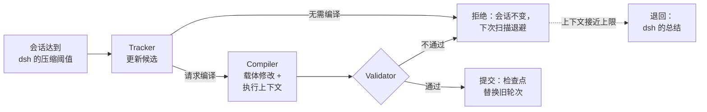

<h1 align="center">dsh-carryon</h1>

<p align="center">
  <strong>为 DeepSeek Harness 提供 CarryOn 上下文折叠：长会话保留已确立的进展，而不是整段历史。</strong>
</p>

<p align="center">
  <a href="https://ethannju.github.io/carryon/"></a>
  <a href="https://arxiv.org/abs/2610.18784"></a>
  <a href="https://huggingface.co/papers/2610.18784"></a>
  <a href="https://www.npmjs.com/package/dsh-carryon"></a>
  <a href="https://github.com/xuan-tu-ai/dsh-carryon/actions/workflows/ci.yml"></a>
  <a href="https://github.com/xuan-tu-ai/dsh-carryon/blob/main/LICENSE"></a>
  <a href="https://github.com/deepseek-ai/deepseek-harness"></a>
  
</p>

<p align="center">
  <a href="https://github.com/xuan-tu-ai/dsh-carryon/blob/main/README.md">English</a> · <strong>简体中文</strong>
</p>

[DeepSeek Harness](https://github.com/deepseek-ai/deepseek-harness)（dsh）的会话变长时，dsh 会把较早的轮次总结成一段自由文本来压缩上下文。dsh-carryon 用论文 [*Pack Light, CarryOn*](https://arxiv.org/abs/2610.18784) 中的 **CarryOn** 替换这一步：较早的轮次被折叠（fold）成两部分。一部分是记录智能体已确立内容的小型、带版本的记录，称为“载体”（carrier）。另一部分是执行上下文，包含任务、未完成的义务和下一步。每次折叠在提交前都会经过校验，被拒绝的折叠不会改变任何东西。

https://github.com/user-attachments/assets/5f4a6889-5cf6-41a4-aff1-327a9d5d6b7b

<p align="center"><sub>论文作者制作的 CarryOn 演示视频，也可在<a href="https://ethannju.github.io/carryon/">项目主页</a>观看。</sub></p>

<p align="center"></p>
<p align="center"><sub>论文中的 CarryOn 运行时示意图。在 dsh-carryon 中，何时折叠以及保留哪些最近轮次由 dsh 决定；Grounder 尚未移植（<a href="https://github.com/xuan-tu-ai/dsh-carryon/blob/main/docs/how-it-works.md">详情</a>，英文）。</sub></p>

[配置](https://github.com/xuan-tu-ai/dsh-carryon/blob/main/docs/configuration.md) · [工作原理](https://github.com/xuan-tu-ai/dsh-carryon/blob/main/docs/how-it-works.md) · [开发](https://github.com/xuan-tu-ai/dsh-carryon/blob/main/docs/development.md) · [基准测试](https://github.com/xuan-tu-ai/dsh-carryon/blob/main/bench/README.md) · [故障排除](https://github.com/xuan-tu-ai/dsh-carryon/blob/main/docs/troubleshooting.md) · [发布](https://github.com/xuan-tu-ai/dsh-carryon/blob/main/docs/release.md) · [更新日志](https://github.com/xuan-tu-ai/dsh-carryon/blob/main/CHANGELOG.md)

以上文档为英文。

## 特性

- **直接替换。** 在终端、headless、SDK 和 ACP 配置中，dsh-carryon 替换 dsh 的压缩后端。触发条件、原样保留的尾部和安全检查仍由 dsh 负责，`/compact` 照常可用。
- **Web UI 中的 CarryOn mode。** 插件在 Standard mode 旁边新增一个模式，可以在同一个应用里对比两者。
- **折叠经过校验。** 未通过校验的折叠不会改动会话，之后的扫描按论文的方式退避。接近上下文上限时，失败的折叠会退回到 dsh 自己的总结，会话得以继续。
- **可恢复。** 折叠状态以可读的 JSON 保存在会话日志中，恢复会话时会重建。
- **移植而非重写。** 运行时是 [carrycode](https://github.com/xuan-tu-ai/carrycode) 的 TypeScript 移植，逐条对照其一致性测试用例（parity fixtures）检查。

## 工作原理



检查点包含所有载体和执行上下文，dsh 会在它之后原样保留最近的轮次。每次折叠调用一次 Tracker；Tracker 请求编译时，再调用一次 Compiler。dsh 自带的压缩只调用一次总结。引擎、状态格式以及本移植与论文的差异，见[工作原理](https://github.com/xuan-tu-ai/dsh-carryon/blob/main/docs/how-it-works.md)。

## 论文报告的结果

以下结果来自论文（Lu、McAuley、Zhang，2026），智能体使用 Claude Opus 4.7。dsh-carryon 尚未对照这些结果做过基准测试。

<p align="center"></p>
<p align="center"><sub>OSWorld 2.0。CarryOn 提高了同一个 Claude Opus 4.7 智能体的二值得分和部分得分，同时把每个任务的成本降低 35.9%。图片来自论文作者。</sub></p>

<p align="center"></p>
<p align="center"><sub>OSWorld 2.0 上上下文与成本随智能体轮次的变化。基线的输入上下文持续增长到 200K token 以上，而 CarryOn 稳定在约 65K。图片来自论文作者。</sub></p>

在 BrowseComp-Plus 上，论文报告准确率从 49.0% 提升到 56.0%，每个任务的 token 减少 22.9%。

## 快速开始

需要 [dsh](https://github.com/deepseek-ai/deepseek-harness) **0.2.2-alpha.3**（每个 dsh-carryon 版本只支持一个 dsh 版本）、Node.js 24.9 或更高版本（dsh 自身的要求），以及 `PATH` 中可用的 pnpm（`npm install -g pnpm`），`dsh plugin` 会调用它。

把插件安装到你使用的配置（profile）中。终端界面：

```bash
npx @deepseek-ai/dsh@0.2.2-alpha.3 plugin --profile tui add dsh-carryon
```

Web UI：

```bash
npx @deepseek-ai/dsh@0.2.2-alpha.3 plugin --profile web add dsh-carryon
```

如果已全局安装 dsh 0.2.2-alpha.3，可以省略 `npx @deepseek-ai/dsh@0.2.2-alpha.3` 前缀，例如
`dsh plugin --profile tui add dsh-carryon`。下面的命令同样如此。

重启 dsh：`npx @deepseek-ai/dsh@0.2.2-alpha.3` 打开终端界面，`npx @deepseek-ai/dsh@0.2.2-alpha.3 web` 启动 Web UI 并打印其地址。在终端界面中，每次压缩都会变成一次 CarryOn 折叠。在 Web UI 中，新会话默认使用 **CarryOn mode**，可以在输入框旁的模式菜单中切换：

<p align="center">
  
</p>

### 检查、更新、卸载

`dsh plugin` 会把参数转交给配置目录中的 pnpm，所以 pnpm 的命令都可以使用。检查插件是否已安装：

```bash
npx @deepseek-ai/dsh@0.2.2-alpha.3 plugin --profile tui list
```

在 Web UI 中，插件也会出现在 **Plugins → Installed plugins** 中。会话长到触发压缩（或执行 `/compact`）后，折叠的检查点显示在 dsh 显示压缩总结的位置，完整状态在 Trajectory → Raw Output 中。

更新到适用于你的 dsh 版本的最新发布：

```bash
npx @deepseek-ai/dsh@0.2.2-alpha.3 plugin --profile tui update dsh-carryon
```

卸载：

```bash
npx @deepseek-ai/dsh@0.2.2-alpha.3 plugin --profile tui remove dsh-carryon
```

Web UI 请使用 `--profile web`。遇到问题？见[故障排除](https://github.com/xuan-tu-ai/dsh-carryon/blob/main/docs/troubleshooting.md)（英文）。

## 配置

插件的配置行是 `carryon-compaction`。它接受 dsh 自带压缩的键（`thresholdRatio`、`retainTokens` 等），以及少量 CarryOn 专用的键。例如，下面的配置写入 `$DSH_HOME/profiles/tui/cordis.patch.yml` 后，会在上下文窗口用到一半时折叠，并让 CarryOn 的角色调用使用更便宜的 `deepseek-flash`：

```yaml
- id: carryon-compaction
  config:
    thresholdRatio: 0.5
    runtimeProvider: deepseek-official
    runtimeModel: deepseek-flash
```

dsh 会用补丁中的 `config` 整体替换该行的配置，所以请把所有要改的键写在一起。全部键、默认值以及 Web UI 中的限制见[配置](https://github.com/xuan-tu-ai/dsh-carryon/blob/main/docs/configuration.md)。

## 引用

dsh-carryon 实现的是这篇论文的方法。如果你在研究中使用它，请引用该论文：

```bibtex
@misc{lu2026carryon,
  title         = {Pack Light, CarryOn: Building Object-Oriented Context for Long-Horizon Agents},
  author        = {Lu, Yuchen and McAuley, Julian and Zhang, Lei},
  year          = {2026},
  eprint        = {2610.18784},
  archivePrefix = {arXiv},
  primaryClass  = {cs.AI},
  url           = {https://arxiv.org/abs/2610.18784}
}
```

carrycode 和 dsh-carryon 是仅依据论文完成的独立实现，与论文作者及 DeepSeek 均无关联。

## 许可证

dsh-carryon 的代码采用 [Apache-2.0](https://github.com/xuan-tu-ai/dsh-carryon/blob/main/LICENSE)。上文的演示视频和图片属于论文作者，经作者许可在此展示，不在该许可证范围内。
